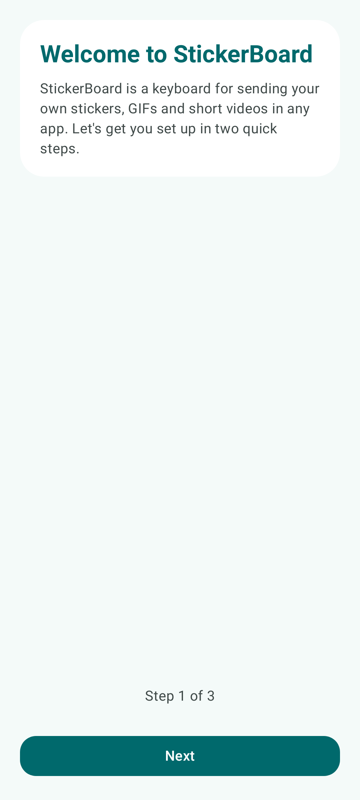
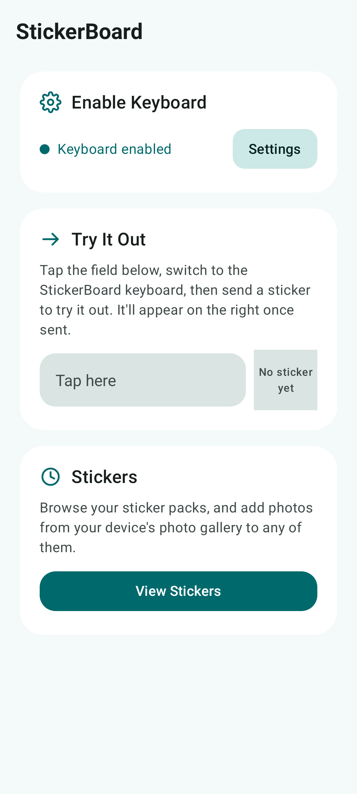
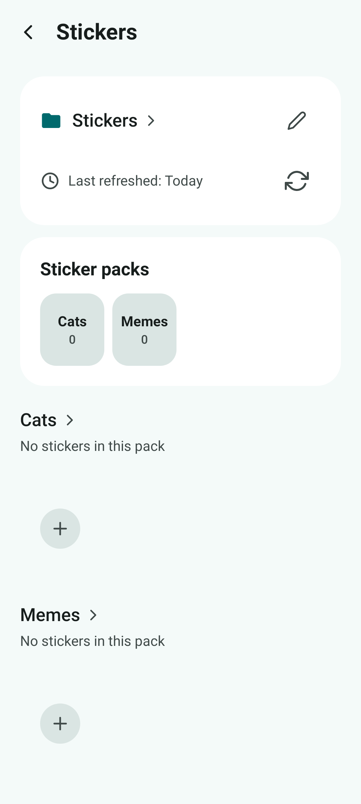
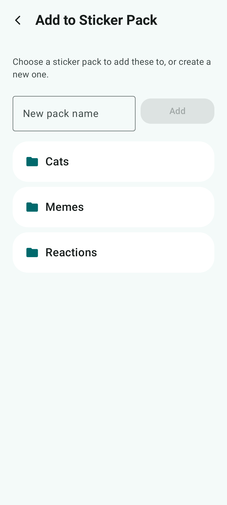

<!-- Generated from readme.yml by LukeNeedham/ci-workflows (docs/readme.md). Edit readme.yml, not this file. -->
<p align="center">
  
</p>

# StickerBoard

An Android keyboard for sending your own stickers, GIFs and short videos in any app.

## Description

StickerBoard is an Android keyboard for sending your own stickers, GIFs and short videos in any app. 

Recently used stickers get their own section, a built-in search finds stickers by file or pack name, keyboard is fully resizable, and a long press previews a sticker before it is sent. The gallery in the app browses every pack and adds photos from your gallery into any of them.

## Screenshots






## Getting started as a user

1. Install the latest build from the [AppHub](https://www.lukeneedham.com/apphub) app, or download the APK from the [Releases](https://github.com/LukeNeedham/Stickerboard/releases) page.
2. {'Open the app and follow the setup': 'enable the keyboard, then choose the folder your stickers are in.'}
3. Switch to StickerBoard from any text field and tap a sticker to send it.

Requires Android 8.0 (API 26) or newer.

## Getting started as a developer

Requirements: JDK 17 and the Android SDK (platform 36), for example through Android Studio.

```
git clone https://github.com/LukeNeedham/Stickerboard.git
cd Stickerboard
./gradlew assembleDebug    # the APK is in app/build/outputs/apk/debug/
./gradlew test             # unit tests
```

Every pull request is built by CI, which comments on it with a link to install the APK.

Like all my apps, it follows the shared architecture and conventions (single activity, Jetpack Compose, Navigation 3, MVVM with every page split into a `Page` and a `PageContent`, Koin): see [ci-workflows](https://github.com/LukeNeedham/ci-workflows/blob/main/docs/new-app.md).

This app started life as a fork of [EweSticker](https://github.com/FredHappyface/Android.EweSticker).

`./gradlew assemblePerf` builds a non-debuggable, debug-signed APK for judging performance (debug builds are much
slower at things like scrolling Compose lists); pull request CI builds only the debug APK, so build it locally.
`./gradlew ktlintCheck` and `./gradlew ktlintFormat` check and format the code.

Code style is enforced with [ktlint](https://github.com/JLLeitschuh/ktlint-gradle), and
[pre-commit](https://pre-commit.com/) hooks in `.pre-commit-config.yaml` catch trailing whitespace, oversized
images and merge conflict markers before a commit is made.

## Contributing

Branch from `main`, make the change, and open a pull request. CI must be green before it is merged.

## License

MIT. See [LICENSE](LICENSE).
